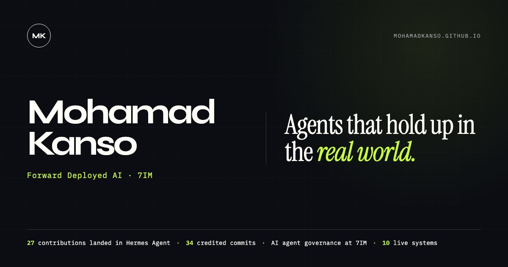

# Mohamad Kanso — Portfolio

[mohamadkanso.github.io](https://mohamadkanso.github.io/) is the portfolio of Mohamad Kanso, a London-based Senior Forward Deployed AI Associate at 7IM.



## Signal / Noise

The experience is built around a living visual system that turns disorder into structure as visitors move through the work. Project chapters reshape the same signal into workflow graphs, privacy gates, code scans, agent orbits, incident shockwaves and market traces.

The cinematic path is paired with a fast 60-second view, direct CV and contact links, full keyboard support, a reduced-motion mode and a filterable public-project archive.

## Featured work

- Hermes Agent — open-source contributions ([the record](https://mohamadkanso.github.io/hermes-contributions/))
- SignalBrief
- IncidentForge
- VoiceSafeKit
- CodeSentry
- WorkflowForge
- Intent Graph
- MLT Terminal
- MLT Journal
- Life Orbit

The social preview is rendered from `assets/preview/social-source.html` with headless Chrome; the render command is in that file.

## Local preview

```bash
python3 -m http.server 4173 --bind 127.0.0.1
```

Open [http://127.0.0.1:4173](http://127.0.0.1:4173).
