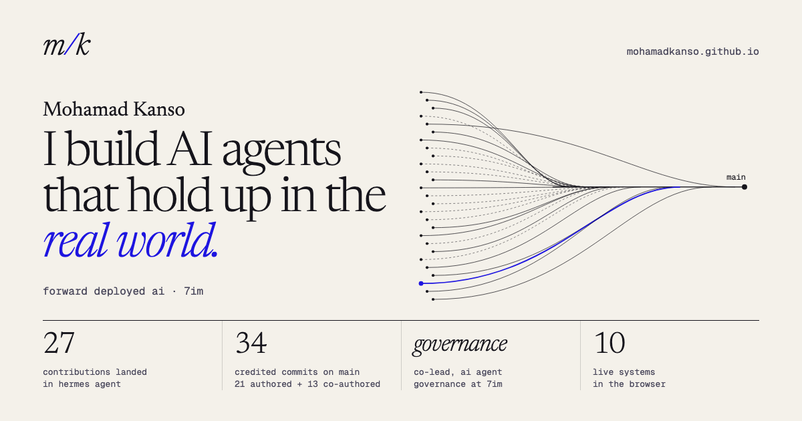

# Mohamad Kanso — portfolio

[mohamadkanso.github.io](https://mohamadkanso.github.io/) is the portfolio of Mohamad Kanso, a London-based Senior Forward Deployed AI Associate at 7IM.



## Design

An editorial, evidence-first page: warm paper, near-black ink, Newsreader (variable, optical sizes) for the voice and Geist Mono for labels. Ultramarine is reserved for things that are live: the graph, links and focus.

The hero centrepiece is a canvas drawing of every Hermes Agent contribution as a path from the original pull request into `main`, joining at its real merge date. Hover a branch to see the pull request, click to open it. The same paths are exposed as an ordered list of links for keyboard and screen-reader users.

Motion uses GSAP + ScrollTrigger, Lenis and SplitType, loaded after first paint and only when motion is allowed. `prefers-reduced-motion` and the header toggle give a fully static page.

## Featured work

1. Hermes Agent — open-source contributions ([the record](https://mohamadkanso.github.io/hermes-contributions/))
2. SignalBrief
3. IncidentForge
4. VoiceSafeKit
5. CodeSentry
6. WorkflowForge
7. Intent Graph
8. MLT Terminal
9. MLT Journal
10. Life Orbit

## Develop

```sh
npm ci
npm run dev        # local server
npm run build      # type-check and production build to dist/
npm run data       # refresh src/data/hermes.json from the public contribution record
npm run shots      # recapture live demo stills with Playwright
npm run qa         # screenshot every section at 1440px and 390px
```

Every Hermes number on the page comes from `src/data/hermes.json`, a snapshot of the public record at mohamadkanso.github.io/hermes-contributions. The social preview is rendered from `public/assets/preview/social-source.html` with headless Chrome; the command is in that file.

Fonts are self-hosted under `public/fonts` (SIL Open Font License, licences included). GitHub Pages deploys `dist/` through `.github/workflows/pages.yml`.
